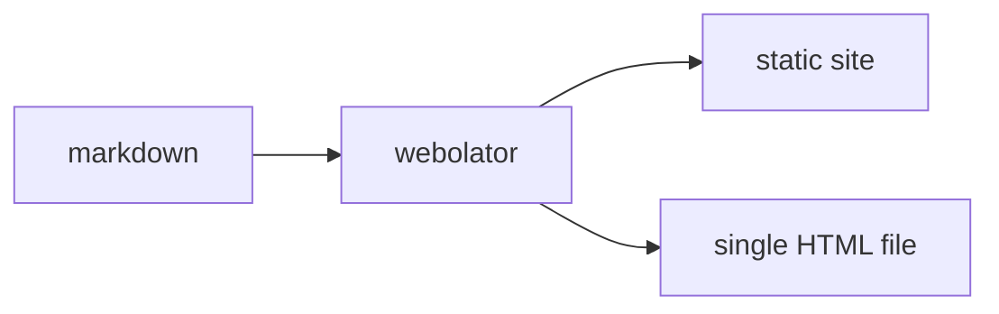

# Code and diagrams

Code is highlighted when the site is built, and a title can sit above the block:

```rust title="src/main.rs"
fn main() {
    println!("Hello from Acme");
}
```

Mermaid diagrams are drawn in the browser, and you can pan and zoom them by clicking:



Tabs can hold diagrams as well:

=== "Flow"

    ```mermaid
    flowchart TD
        Docs --> Build --> Deploy
    ```

=== "Sequence"

    ```mermaid
    sequenceDiagram
        You->>webolator: markdown
        webolator-->>You: website
    ```
